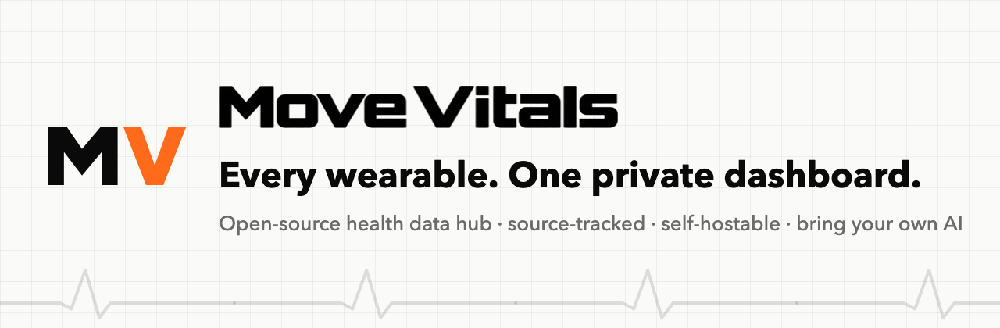
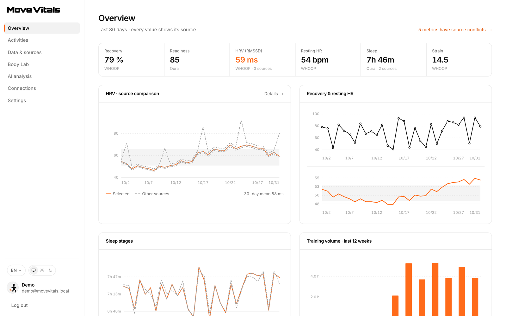
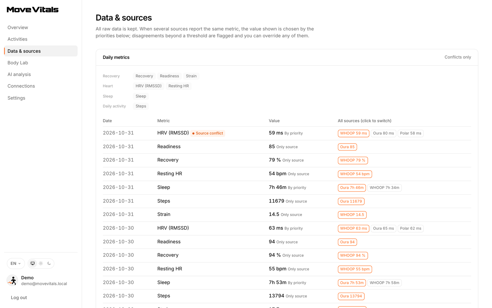
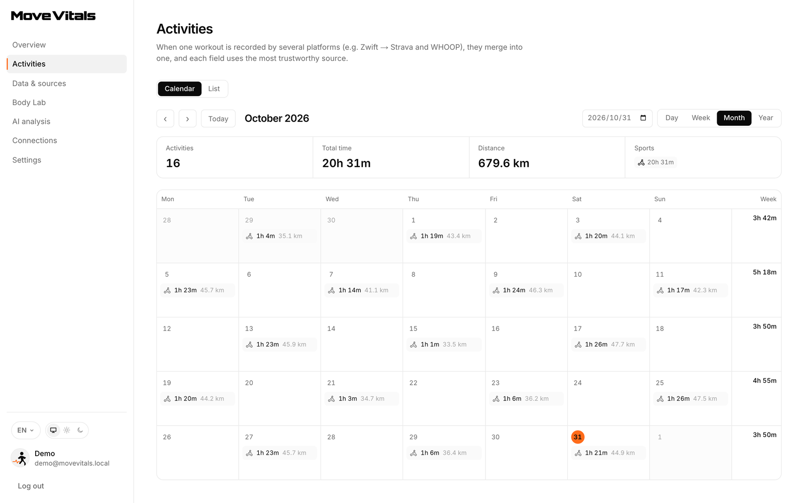
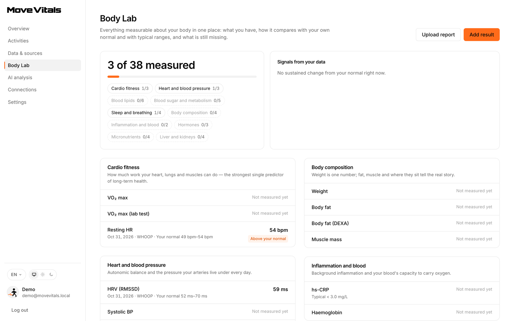
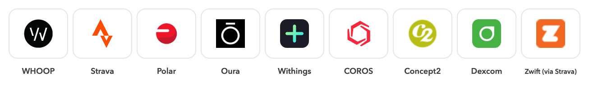
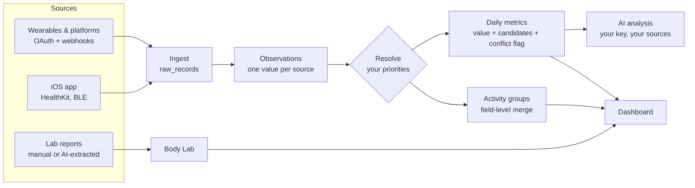

<p align="center">
  <picture>
    <source media="(prefers-color-scheme: dark)" srcset=".github/assets/hero-dark.png">
    
  </picture>
</p>

<p align="center">
  <b>The open-source, self-hostable health data hub.</b><br>
  Bring WHOOP, Oura, Polar, Strava, COROS, Withings and more into one dashboard —<br>
  every value keeps its source, conflicts stay visible, and AI analysis runs on <i>your</i> key.
</p>

<p align="center">
  <a href="https://movevitals.com"><b>Hosted version</b></a> ·
  <a href="#-quick-start">Quick start</a> ·
  <a href="#-self-hosting">Self-hosting</a> ·
  <a href="docs/providers.md">Integrations setup</a> ·
  <a href="https://movevitals.com/en/guides">Guides</a> ·
  <a href="CONTRIBUTING.md">Contributing</a>
</p>

<p align="center">
  <a href="https://github.com/AkinoHu/MoveVitals-OpenSource/actions/workflows/ci.yml"></a>
  <a href="LICENSE"></a>
  
  
  
  
  <a href="https://github.com/AkinoHu/MoveVitals-OpenSource/stargazers"></a>
</p>

<p align="center">
  <picture>
    <source media="(prefers-color-scheme: dark)" srcset=".github/assets/overview-dark.png">
    
  </picture>
</p>

> [!NOTE]
> This repository is the **dashboard and integration platform** behind [movevitals.com](https://movevitals.com). The marketing site, guides and content tools are not part of it. Screenshots show synthetic demo data.

---

## ✨ Why MoveVitals

|  |  |
|---|---|
| 🧾 **Provenance first** | Every value keeps the platform it arrived through, the original recorder (e.g. *Magene T600 · Zwift via Strava*), the device and the raw payload. Nothing is silently overwritten. |
| ⚖️ **Conflicts are visible** | WHOOP says 64 ms, Oura says 54 ms? Both are stored. Your source priorities pick the value shown, disagreements are flagged, and you can override any day. |
| 🧩 **Field-level workout merging** | The same ride from a trainer, a strap and a watch becomes one activity: power from the trainer, heart rate from the strap, distance from the watch — counted once. |
| 🧪 **Body Lab** | Personal baselines and alerts for HRV, resting heart rate and more. Add lab results by hand or upload a report and let your AI model extract the values for you to confirm. |
| 🤖 **Your model, your key** | Ask questions with Claude, OpenAI-compatible APIs, DeepSeek, Qwen or a local Ollama. You choose which sources it can see; data from platforms that forbid AI use (Strava) is excluded by default. |
| 🔒 **Yours to run** | AGPL-3.0, self-hostable, full export and one-click deletion. Official APIs only — no scraping, no reverse engineering. Five languages out of the box. |

## 🖼️ A closer look

<table>
  <tr>
    <td width="33%"></td>
    <td width="33%"></td>
    <td width="33%"></td>
  </tr>
  <tr>
    <td align="center"><b>Data &amp; sources</b><br><sub>All readings side by side, conflicts flagged</sub></td>
    <td align="center"><b>Activities</b><br><sub>Duplicates merged into one workout</sub></td>
    <td align="center"><b>Body Lab</b><br><sub>Baselines, alerts and lab results</sub></td>
  </tr>
</table>

## 🔌 Integrations

<p align="center">
  <picture>
    <source media="(prefers-color-scheme: dark)" srcset=".github/assets/integrations-dark.png">
    
  </picture>
</p>

| How it connects | Platforms |
|---|---|
| **Direct, official API** | WHOOP · Strava · Polar · Oura · Withings · COROS (official MCP) · Concept2 Logbook · Dexcom |
| **Relayed, original source kept** | Zwift, Rouvy, MyWhoosh and indoor trainers via Strava |
| **iOS app** ([`ios/`](ios)) | Apple Health, Polar H10 raw data, Bluetooth sensors |
| **Hosted version only** | Garmin, Suunto, Wahoo — their developer programmes keep API material confidential |

Each platform needs its own developer app registered by whoever runs the instance — see [docs/providers.md](docs/providers.md). Want another one? Read [adding a provider](docs/adding-a-provider.md).

## 🧭 How it works



| Layer | Where |
|---|---|
| Provider adapters (OAuth, webhooks, parsers) | [`src/lib/providers/`](src/lib/providers) |
| Idempotent ingest, raw archive | [`src/lib/ingest.ts`](src/lib/ingest.ts) |
| Conflict resolution and merging | [`src/lib/resolve.ts`](src/lib/resolve.ts) |
| Sync, token refresh, webhook queue | [`src/lib/sync.ts`](src/lib/sync.ts), [`worker/`](worker) |
| Bring-your-own-key AI | [`src/lib/ai.ts`](src/lib/ai.ts) |
| Body Lab | [`src/lib/lab/`](src/lib/lab) |

## 🚀 Quick start

```bash
git clone https://github.com/AkinoHu/MoveVitals-OpenSource
cd MoveVitals-OpenSource
pnpm install
cp .env.example .env.local     # then set ENCRYPTION_KEY: openssl rand -base64 32
pnpm seed:demo                 # optional: demo@movevitals.local / demo-password
pnpm dev                       # http://localhost:3000
```

No database setup needed: without `DATABASE_URL`, an embedded PGlite database is created in `.data/`.

## 🏠 Self-hosting

| What | How |
|---|---|
| **App** | `pnpm build && pnpm start` — Next.js 16 on Node 22; migrations run on start |
| **Worker** | `pnpm worker` — scheduled sync, webhook retries, backups |
| **Database** | PostgreSQL via `DATABASE_URL` |
| **Required env** | `APP_URL`, `ENCRYPTION_KEY`, `DATABASE_URL` |
| **Optional** | OAuth apps per platform, email (`RESEND_API_KEY`), Google sign-in, AI, S3-compatible backups — all in [`.env.example`](.env.example) |
| **Admin console** | `/admin` (users, backups, integration requests) for addresses in `ADMIN_EMAILS`; the email must be verified |
| **Legal pages** | Set `NEXT_PUBLIC_PRIVACY_URL` and `NEXT_PUBLIC_TERMS_URL` to show your own policies at sign-up |

Running a public instance? Please rename it and replace the logos in `public/` — see [TRADEMARKS.md](TRADEMARKS.md).

## 🗺️ Roadmap

- [x] Multi-source ingest with provenance and conflict resolution
- [x] Field-level workout merging across platforms
- [x] Body Lab: baselines, alerts, lab results with AI extraction
- [x] Bring-your-own-key AI analysis
- [x] COROS via the official MCP
- [ ] Public release of the iOS app (Apple Health, Bluetooth sensors)
- [ ] Docker image and one-click deploy templates
- [ ] Android / Health Connect
- [ ] More official integrations — [request one](https://github.com/AkinoHu/MoveVitals-OpenSource/issues/new/choose)

## 🤝 Contributing

Issues and pull requests are welcome. Start with [CONTRIBUTING.md](CONTRIBUTING.md): official APIs only, never overwrite another source's data, translate every UI string. Pull requests are accepted under the [Contributor License Agreement](CLA.md). Security issues go privately to hello@movevitals.com — see [SECURITY.md](SECURITY.md).

<a href="https://github.com/AkinoHu/MoveVitals-OpenSource/graphs/contributors"></a>

## ⭐ Star history

<a href="https://star-history.com/#AkinoHu/MoveVitals-OpenSource&Date">
  <picture>
    <source media="(prefers-color-scheme: dark)" srcset="https://api.star-history.com/svg?repos=AkinoHu/MoveVitals-OpenSource&type=Date&theme=dark">
    
  </picture>
</a>

## 📄 License

[AGPL-3.0](LICENSE). If you run a modified version as a network service, you must offer its source to your users. "MoveVitals" and the MoveVitals logo are trademarks and are not covered by the code licence — see [TRADEMARKS.md](TRADEMARKS.md).

<p align="center"><sub>Made by <a href="https://movevitals.com">MoveVitals Lab</a> · <a href="https://x.com/AkinoHuuu">X</a> · <a href="mailto:hello@movevitals.com">hello@movevitals.com</a></sub></p>
